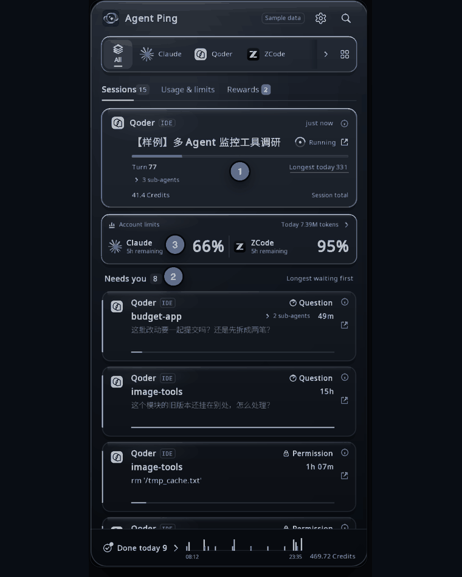
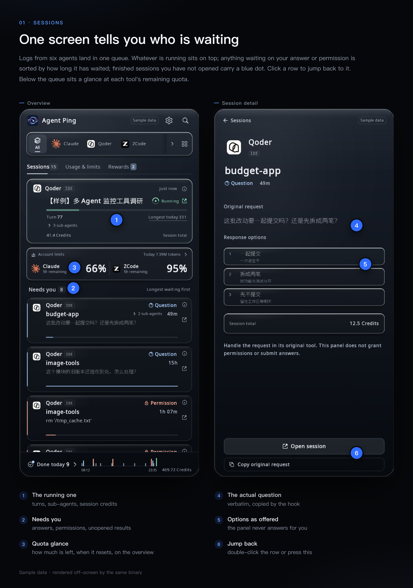
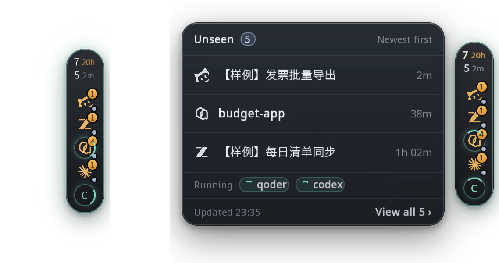
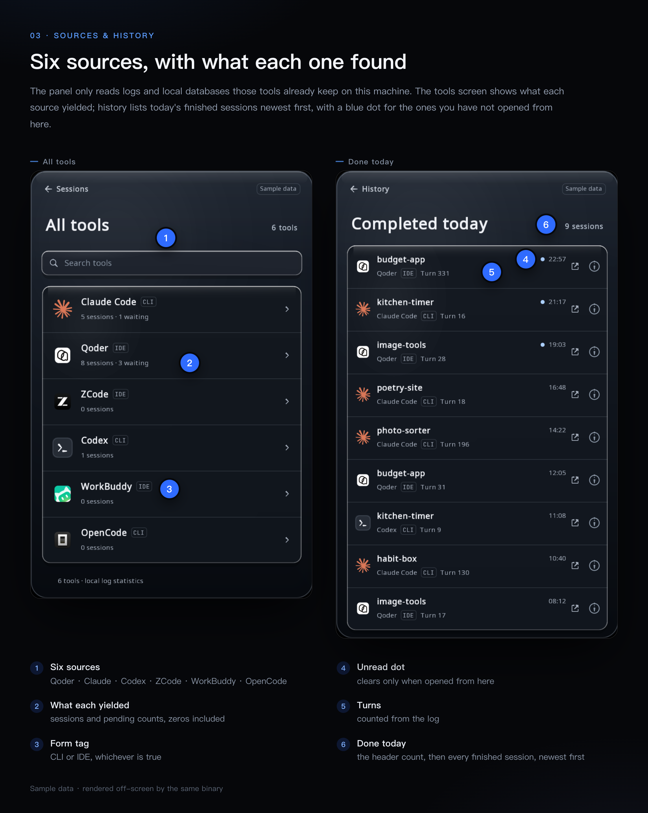

# Agent Ping


[中文](README.zh-CN.md) · [Product page](https://dreamofxm.github.io/agent-ping/en/)

[Install](#install) · [Usage](#usage) · [Privacy](#privacy) · [Limitations](#limitations)

When several agent tools run at once, it is easy to miss which one finished and
which one is waiting for your approval. Agent Ping reads the local logs those
tools already write, puts what needs you on the screen's right edge, and takes
you back to the session on a double-click.

[](docs/agent-ping-teaser.gif)

## Install

On macOS 13 or later, install the prebuilt app. On Linux with X11, build from
source. Windows is not supported.

```sh
brew tap DreamOfXM/agent-ping https://github.com/DreamOfXM/agent-ping
brew trust dreamofxm/agent-ping          # third-party tap, run once
brew install --cask agent-ping
```

The bundle carries its own glfw and freetype, so nothing else has to be installed
first. The download is signed with a Developer ID and notarized by Apple, so macOS
won't refuse it as an unidentified developer. If it warns anyway, don't bypass the
warning — report it in [Issues](https://github.com/DreamOfXM/agent-ping/issues).

To compile it yourself, or when 26 MB won't come down, the formula from the same
tap builds it locally; it needs Xcode Command Line Tools and takes about a minute
on Apple silicon:

```sh
brew tap DreamOfXM/agent-ping https://github.com/DreamOfXM/agent-ping
brew trust dreamofxm/agent-ping
brew install agent-ping && agent-ping
```

<details>
<summary>brew stops at Homebrew's Xcode admission check</summary>

`Error: Xcode alone is not sufficient…` is Homebrew's requirement for source
builds, not this project's; if your Command Line Tools are too old, update them in
System Settings → Software Update. Or take the cask above — it never touches a
compiler.

</details>

Upgrade and uninstall follow the path you installed by:

```sh
# refresh the tap first
brew update

# installed by cask
brew upgrade --cask agent-ping

# installed by formula
brew upgrade agent-ping
```

```sh
# installed by cask
brew uninstall --cask agent-ping

# installed by formula
brew uninstall agent-ping && brew untap DreamOfXM/agent-ping
```

Installed both ways and you get two menu-bar icons — keep one.

## Usage

Today the answer to "who is waiting" costs switching windows and reading the last
line of each terminal. Here it is one list on the screen edge, and one
double-click back into the session that asked.

- **Menu bar only.** Open it once from Launchpad: there is no Dock icon and no
  window to switch back to, only a star-in-an-ellipse icon at the right end of the
  menu bar, next to the clock. The panel opens on the first launch.
- **Overview** queues the sessions waiting for approval, waiting for an answer, or
  stopped with an error. Double-click a row to jump back to that session.
- **Usage & limits** and **Rewards** show each tool's balance, today's usage, and
  the claim state the vendor records itself.
- **Right-edge column.** With the panel away, a 44pt column stays on the screen's
  right edge: who is waiting, who just finished, no window switching.
- **Reminders** dedupe per session and fire once. If the banner can't be sent,
  sound replaces it. "Do not disturb" only pauses sending.
- **Six UI languages** built in (zh / en / de / it / ja / ko), switched in
  Settings.

[](docs/fig-01-queue-en.png)

*All figures in this README are rendered by the app itself with demo data; the
"sample data" tag is the product's own.*

[](docs/fig-04-edge-en.png)

**Where do the numbers come from?** Every number is read off the local logs each
tool writes itself, with no billing API and no conversion to money; a cell stays
empty when the log doesn't carry it. The per-screen tour and the full definition
of each number are on the [product page](https://dreamofxm.github.io/agent-ping/en/).

**Want the verbatim question and its options?** Reading logs alone isn't enough —
you need the hook: for Claude Code and Qoder CLI, one click on the panel's
**Wiring** screen installs it. The hook only copies the question into a local
inbox; it never answers for you.

## Privacy

[](docs/fig-03-sources-en.png)

No server, no account, no telemetry. Every item below reads a file your own tool
already has. Nothing is uploaded, and the binary makes no network calls.

- **Qoder CLI** — `~/.qoder/projects/**/*.jsonl`: sessions, titles, working directories, timestamps, token and Credits usage, turn counts
- **Claude Code** — `~/.claude/projects/**/*.jsonl`: same, except it records no Credits
- **Codex** — `~/.codex/sessions/**`: sessions, working directories, token usage, results, quota-window readings
- **ZCode** — `~/.zcode/cli/db/db.sqlite`: session list, last message per session, token usage, sub-agent records, plus the pending "waiting for your answer" (read-only)
- **WorkBuddy** — `~/.workbuddy/workbuddy.db`, `~/.workbuddy/projects`: sessions, token usage
- **OpenCode** — `~/.local/share/opencode/opencode.db` (honors `$XDG_DATA_HOME`): titles, working directories, update times, token usage, tool status (read-only)
- **Reward claims** — `~/.workbuddy/logs/main.log`, `~/Library/Application Support/com.qoder.app.stable/logs/*/main.log`, `~/.zcode/v2/logs/<date>.log`: each vendor's own check-in results, claimable states, face value and expiry
- **Account balances** — `~/.codex/sessions/**`, `~/Library/Application Support/com.qoder.app.stable/logs/*/main.log`, `~/.zcode/v2/logs/<date>.log`: each vendor's own "remaining / total" reading and when it was written
- **Hook inbox** — `~/Library/Application Support/AgentPing/hooks/*.json`: the verbatim questions waiting on you and their options. Has content only if you installed the hook

On Linux, Agent Ping's own paths live under `$XDG_CONFIG_HOME` and
`$XDG_DATA_HOME` (falling back to `~/.config` and `~/.local/share`).

It does **not** read Keychain, secrets in environment variables, auth tokens,
shell history, or anything beyond the fields listed above.

It writes only: two record files in its state directory (reminder dedupe,
settings, unread marks); `hook.sh` and two CLI configs when you install the hook
(backed up byte-for-byte first); the login item when "start at login" is on; a
temp log on Linux when a notification fails.

Session titles appear on screen and reminders quote them — keep this in mind when
sharing screenshots.

## Limitations

Read this before filing an issue; every item has a reason:

- **macOS banners can be refused by the system.** Allow Agent Ping in System
  Settings → Notifications. Until then the panel falls back to sound.
- **Jumping into a ZCode session is a detour, not an API.** The panel types the
  session's search term into ZCode's own ⌘K palette; needs Accessibility
  permission. Without it, only app activation works.
- **Unread dots don't sync with the tools.** A dot means "not opened through this
  panel".
- **Reward cards confirm after the fact.** A missed period isn't in local logs, so
  there is no preview; readings only change when each vendor writes to disk.
- **Linux reminders and sound are young.** Verified in containers only, not on a
  real KDE/GNOME desktop or real hardware. Missing dependencies degrade to a plain
  window without a tray icon.
- **On Linux, clicking a banner doesn't jump to the session.** It activates the
  app or opens the session's working directory.
- **Six sources, not "every agent".** Qoder CLI, Claude Code, Codex, ZCode,
  WorkBuddy, OpenCode. The last three need a SQLite3 build.
- **No real background blur; the tray icon is subtle on dark menu bars.** The
  glass surface is hand-drawn; fixing the icon means redrawing the finalized
  logo.
- **Search-box keyboard focus is unverified.** ⌘/Ctrl+F and Esc are wired; if
  typing doesn't filter, please file an issue.
- **Settings, Wiring and Authorization screens still use the old layout.** The
  rest have been redone; these three will follow.
- **The resource-reset card is not implemented.** No local log carries it, so the
  block doesn't show.
- **One tool, one window.** If you never switch between agents, the panel mostly
  repeats what is already in front of you.

## Build

Hard requirements: C++17, CMake ≥ 3.20, Ninja, GLFW3, FreeType 2, OpenGL 3.3
core, and macOS 13+ or Linux with X11.

CMake says plainly what a missing optional dependency costs: without SQLite3 the ZCode, WorkBuddy and OpenCode sources are skipped; on
Linux, without libdbus-1 there is no tray icon, and without libx11 + libxext the
edge column is off. All commands run from the repo root.

macOS (produces `build/AgentPing-cpp.app`):

```sh
brew install cmake ninja glfw freetype
cmake -S . -B build -G Ninja && cmake --build build
sh Tools/make_bundle.sh
```

Linux (Debian 12 package names):

```sh
sudo apt-get install -y cmake ninja-build libglfw3-dev libfreetype6-dev \
    libsqlite3-dev libgl1-mesa-dev libdbus-1-dev libx11-dev libxext-dev
cmake -S . -B build-linux -G Ninja && cmake --build build-linux
# Real reminder behavior needs two more packages: libnotify-bin (banners), sound-theme-freedesktop (sound)
```

On every push to main, CI runs that exact apt command in a Debian 12 container,
then builds and measures the edge column's click-through. The package list is read
from this README, so a broken command fails CI instead of rotting quietly.

Install into the applications menu:

```sh
sudo cmake --install build-linux            # prefix defaults to /usr/local
```

If it doesn't appear in the menu, reinstall with `--prefix /usr`.

## Docs

- [Product page](https://dreamofxm.github.io/agent-ping/en/) — the guided tour,
  category comparison and FAQ live there.
- [Issues](https://github.com/DreamOfXM/agent-ping/issues) — bugs and tools you
  want supported; Chinese or English. Read
  [Limitations](#limitations) first.

## License

Apache License 2.0 — see [LICENSE](LICENSE).

Third-party materials keep their own terms: Dear ImGui is MIT
(`vendor/imgui/LICENSE.txt`), UI fonts are SIL OFL 1.1 (`fonts/LICENSE-*.txt`).
Noto CJK carries the reserved font name `Source`: you may modify it, but modified
versions may not use that name.
