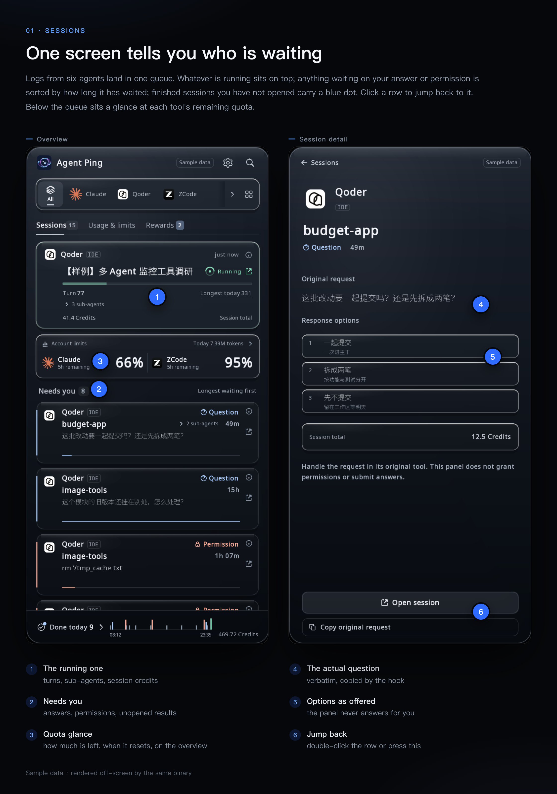
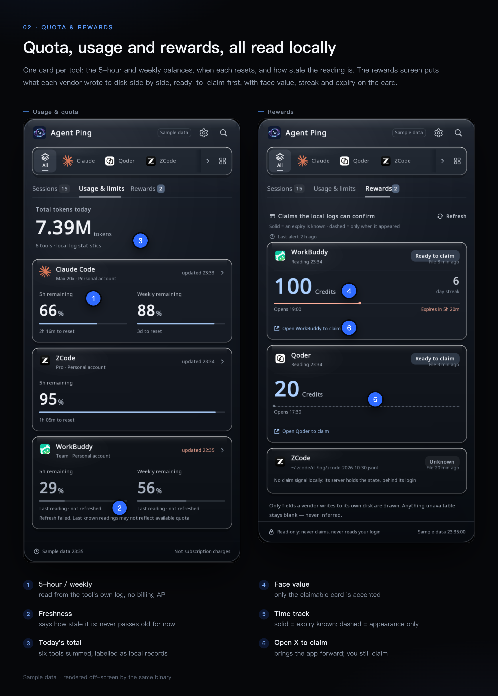
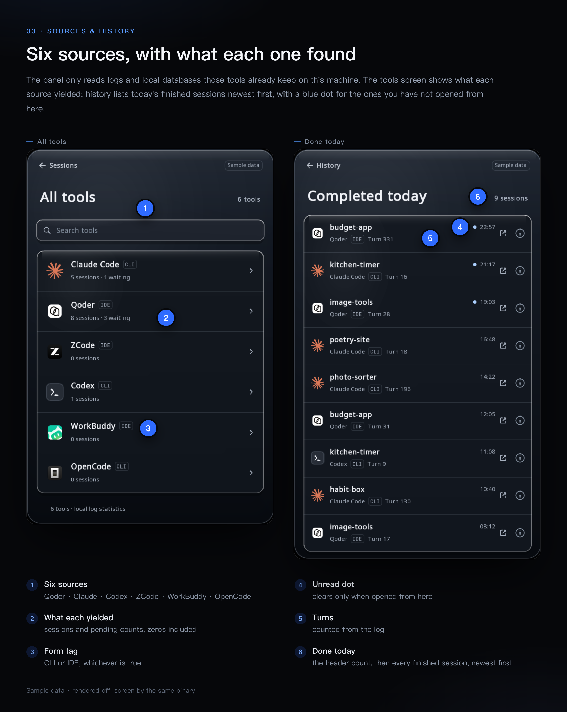

# Agent Ping


[中文](README.zh-CN.md)

When Qoder, Claude Code, Codex, ZCode, WorkBuddy and OpenCode are all open at once,
what you are missing is not another dashboard — it is "which one is my turn". Agent
Ping is a menu-bar panel: it reads the logs and local databases those tools already
write on your machine, works out who is running, who is queued, who stopped with an
error, who is sitting there waiting for an answer, and who just put up a claimable
reward; then it alerts you while you are not looking, and puts the session — or the
rewards screen — in front of you. No server, no account, no telemetry: the binary
makes no network calls (checked with `nm -u`, see
[Privacy](#privacy--exactly-what-it-reads)).



*All three figures in this README are rendered offscreen by the binary this repo
builds (`AGENTPING_FIXTURE=1`), not staged. The **Sample data** pill in the header is
the product's own label: those numbers do not come from any real machine.*

## What it is, and what it deliberately is not

**Is**: a live state monitor, an alert layer, and a way back into the session that
pinged you. The unit of value is one row — one session, one state, one jump target.
Since v0.1 it also shows per-account quota and token usage, because "how much of my
5-hour window is left" is a *right now* question, not an accounting question. Since
October it also puts the reward-claim state three vendors write to their own disks on
screen — read-only, never claiming: clicking a card only brings that vendor's app to
the front.

**Is not**: a cost dashboard, and not an auto-claimer. It never converts anything into
a currency amount, never calls a billing API, never shows a quota it could not read
from a local log, and never presses *Claim* on your behalf. Where a source has no
field for something, the cell is not drawn — it is not filled with `0`. One time
window only: today.

## Screens

Ten views in one window. The rail at the top filters by tool; everything below it is
a view over the same scan round — the table folds Settings, Connect and Permission
into one row.

| View | What answers |
|---|---|
| **Overview** | one running card (turn, sub-agents, session credits), account quota preview, the `Needs you` queue longest-waiting first, and a footer of today's completions |
| **Usage & limits** | today's token total plus one card per tool: 5h / weekly remaining, when each resets, and how stale the reading is |
| **Rewards** | the three vendors' reward cards: whatever is claimable now sorts first, with face value, streak and an expiry countdown on the card; a field the source cannot give stays undrawn |
| **Account** | one tool: total, hourly distribution, input / output / cache read / cache write, per-model split |
| **Detail** | the verbatim question and its options, or the failed command — opened with `ⓘ` on any row |
| **History** | completed sessions, newest first, 12 per page, more pages load as you scroll |
| **Tools** | which collectors are present on this machine and what each one yielded |
| Settings / Connect / Permission | toggles, hook wiring, and the Accessibility prompt |



*A reward card carries three different clocks: when the reading was taken, when the
source file was last written, and the footer's scan time. When they disagree, "we did
not refresh" and "that vendor wrote nothing" become two distinguishable answers.*

## Cross-platform

Both platforms are built and run in CI-by-hand on every release; the split is a
platform shim behind C headers (`src/platform/`), so the panel, scan layer and alert
judgement are one code path.

| | macOS | Linux |
|---|---|---|
| Window | borderless, transparent, follows the menu-bar item | same, via GLFW/X11 |
| Status item | `NSStatusItem` with a three-number label | StatusNotifierItem over D-Bus (needs `libdbus-1-dev`; otherwise a stub with no tray icon) |
| Banner | `UNUserNotificationCenter` | shells out to `notify-send` (from `libnotify-bin`) |
| Sound | `afplay` on a system sound | `paplay` → `pw-play` → `ffplay` → `canberra-gtk-play` → `aplay` → `cxplay`, picked by what is installed and what the file format allows (`aplay` takes only `.wav`, `paplay` not) |
| Autostart | a plist under `~/Library/LaunchAgents` | an entry under `$XDG_CONFIG_HOME/autostart` |
| Jump into a session | URL scheme, AppleScript, or driving the tool's own ⌘K palette | open the session's working directory / activate the app. No palette driver. |
| Language | system locale, overridable | `$LC_*` / `$LANG`, overridable |

Interface text ships in six languages (zh, en, de, it, ja, ko) with a real dropdown
in Settings; fonts are baked per size at startup, so CJK is not a bolt-on.

## How it behaves

These are deliberate choices, each of which cost a bug report to learn:

- **Double-click a row to jump.** A single mis-click costs a collapsed panel and an
  app switch, so a row only fires on a second click on the same row within 0.5 s.
  Small controls (`ⓘ`, the detail screen's *Go to session*, chips) stay single-click.
- **Cards do not move.** Re-scans happen every 3 s and sessions gain output at
  different times; sorting by "last activity" made rows jump out from under the
  cursor. Each session gets a stable sequence number the first time the panel sees
  it, so an established card never changes place.
- **A completed session carries an unread dot** until you open it *through this
  panel*. The watermark is persisted; on first run it starts at "now", so an existing
  backlog does not arrive as 40 unread items.
- **The panel is as tall as its content** (400–850 pt), and the wheel eases toward
  its target instead of teleporting 40 pt per notch.
- **Toggles answer back.** Flipping *Sound* plays one test chime immediately and
  shows a toast, so you learn whether it works now rather than at the next alert.
- **Stale quota retreats.** The overview only previews readings ≤ 10 min old; older
  ones move to the Usage screen with their `updated HH:MM` stamp instead of pinning a
  permanent red "needs refresh" to the first screen.
- **Rewards are read-only.** The card draws only what each vendor writes into its own
  store. Clicking it brings that app to the front and says so — *Claim it inside that
  app yourself — this layer never claims for you*. The whole card is the hit area,
  and the landing stops at the app.

## Privacy — exactly what it reads



Everything below is a read of a file your tools already own. Nothing is uploaded.
The only files Agent Ping writes are listed after the table, and the two config
files are touched only when **you** install a hook (the Connect button or
`Tools/install_hook.sh`).

| Source | Path (macOS) | What is taken from it |
|---|---|---|
| Qoder CLI | `~/.qoder/projects/**/*.jsonl` | session id, title, cwd, timestamps, `message.usage` token/credit fields, user-record count |
| Claude Code | `~/.claude/projects/**/*.jsonl` | same, minus credits (the field does not exist there) |
| Codex | `~/.codex/sessions/**` | `session_meta` (cwd, session id), `token_count` records, outcome, `rate_limits` events |
| ZCode | `~/.zcode/cli/db/db.sqlite` | `chat_sessions` + last message per session, `tokens.input` sum, sub-agent rows (read-only) |
| WorkBuddy | `~/.workbuddy/workbuddy.db`, `~/.workbuddy/projects` | session rows, `providerData.usage.inputTokens` |
| OpenCode | `~/.local/share/opencode/opencode.db` (honours `$XDG_DATA_HOME`) | `session` title/cwd/`time_updated`, `part` `step-finish` token sums and `tool.state.status` (read-only) |
| Rewards | `~/.workbuddy/logs/main.log`, `~/Library/Application Support/com.qoder.app.stable/logs/*/main.log`, `~/.zcode/cli/log/zcode-<date>.jsonl` | WorkBuddy's `[Checkin]` result; Qoder's `[Campaign]` claimable state and its server-side list; for ZCode only whether today's log exists — it writes no reward state locally |
| Hook inbox | `~/Library/Application Support/AgentPing/hooks/*.json` | the verbatim question and its options — written by the small `hook.sh` that Agent Ping installs on request; the panel itself never writes into this directory |

On Linux the two Agent Ping paths move to `$XDG_CONFIG_HOME/AgentPing/…`
(inbox, falling back to `~/.config`) and `$XDG_DATA_HOME/agentping/hook.sh`
(falling back to `~/.local/share`). Set `AGENTPING_HOOK_DIR` to point both the
writer and the panel at a different inbox.

It does **not** read Keychain, environment secrets, auth tokens, shell history, or
your transcripts' contents beyond the fields named above. It opens no socket: the
built binary has no undefined reference to `connect`, `sendto`, `getaddrinfo`,
`socket` or any HTTP client — the only `*connect*` symbols in the Linux build are
`dbus_connection_*`, which is local IPC.

Files it writes:

| File | When |
|---|---|
| `alerted.txt`, `settings.txt` in its state directory | always (dedup ledger, settings, unread watermark) |
| `<hook.sh path>` | only when you install a hook; mode `0755`, written atomically |
| `~/.claude/settings.json` / `~/.qoder/settings.json` | only when you install a hook: one `Notification` entry per matcher, merged into the existing JSON |
| `<that config>.bak-agentping-<YYYYmmdd-HHMMSS>` | immediately before the merge, holding the original bytes |
| macOS `~/Library/LaunchAgents/io.github.dreamofxm.agentping.plist`, Linux `~/.config/autostart/agentping.desktop` | only while the *Launch at login* toggle is on |
| `/tmp/agentping-err-<pid>.log` | Linux only, mode `0600`, only when a notification fails |

Session titles are shown on screen and are what the alert quotes, so treat the
panel the way you treat your own terminal scrollback.

## Where each number comes from

| On screen | Definition | Honest caveat |
|---|---|---|
| Tray `2 · 5` | three counters in a fixed order — needs-you, running, failed — with empty slots omitted | `running` includes queued; which slot is which comes from the tooltip, not the label |
| `Needs you` | sessions waiting on you — permission, an answer, or a run that ended in an error — **plus** today's sessions that finished while you were away and you haven't opened yet | the second group is drawn as `Unseen` rows with a blue mark; it stays out of the tray counters because nobody has to act |
| `Running N` | sessions working **plus** sessions queued | |
| `41.4 Credits` | sum of `message.usage.credits` over assistant records timestamped at or after local midnight | only Qoder CLI emits a `credits` field. This is that vendor's own counter, not our estimate and not money. Vendors without the field contribute 0. |
| `Turn 77` | count of `type:"user"` records without a `toolUseResult` key | no local log carries a total-turn count, so progress is a flowing bar, never a percentage |
| `Longest today 331` | the same turn counter, maximum over today's sessions | |
| `⌄ 3 sub-agents` | ZCode rows with `task_type='subagent_child'` attached to that parent by `parent_id` | ZCode names none of them; the label is derived from the dispatch text and the raw title is what the ⌘K search uses |
| `Total tokens today` | Σ over today's sessions of `input + output + cache_read + cache_write` as each tool reports them | the four parts do **not** mean the same thing across tools — see below |
| `66%` / `2h 16m to reset` | a quota window read out of that tool's own log (e.g. Codex writes `rate_limits` events while it runs) | read locally, never from a billing API; if the tool has been idle, the reading is stale and says so |
| Reward card `100 Credits` / `6` day streak / `Expires in 5h 20m` | face value, streak and this period's expiry, as each vendor writes them to disk | a vendor that does not write a field gets the cell left undrawn; `Claimable` / `Claimed` is its own state bit, not our inference; for the vendor that only reports when a reward appeared, the track is drawn dashed |
| `Hourly` bars | that tool's tokens summed into 24 local-hour buckets | hours with no tokens are left empty, not drawn as zero |

Token counts are summed because the Usage screen asks for it, but the sum mixes
definitions: transcripts add `input + cache_read + cache_creation`, Codex reports a
cumulative total, ZCode stores `tokens.input`, WorkBuddy's `inputTokens` already
includes cache reads, OpenCode writes a per-turn `step-finish` record. That is why
the panel labels the figure *local log statistics*, why each tool card carries its
own `updated HH:MM`, and why the account view states its formula on screen. Per-tool
numbers are the ones to act on; the headline is a shape, not a measurement.

## Alerts

A session alerts once per `(agent, session)` key. The ledger is on disk, so
restarting does not re-alert the whole board. Per round at most 4 alerts fire; the
rest are held and go out on a later round rather than being dropped.
`免打扰` (DND) suppresses new alerts without clearing the ledger.

`ap_notify_post` returns one of four codes, and the difference matters:

| code | meaning | ledger |
|---|---|---|
| 0 | banner delivered | recorded |
| 1 | banner channel unavailable, fell back to a sound | recorded |
| 2 | neither channel works | recorded, surfaced in settings |
| 3 | platform did not answer within the deadline | **key erased** — this round is not counted, so it can retry |

**Reward arrivals** ride the same ledger under a different key
(`claim:<vendor>:<period>`): when a vendor flips from "nothing" to "claimable now",
one banner fires and stays until you dismiss it, and tapping it lands on the Rewards
screen. The *Reward alerts* toggle in Settings turns this path off (on by default),
and DND holds it back too — both only suppress delivery and never clear the ledger,
so reopening does not dump every period that piled up while they were off.

## Connecting a CLI (optional)

The panel can read a session's state from logs alone, but it cannot see the *text*
of a question or a permission prompt without a hook. Two CLIs have a notification
hook that can be written for you:

```sh
./Tools/install_hook.sh status            # what is wired, what is stale
./Tools/install_hook.sh install claude    # or: install qoder
./Tools/install_hook.sh uninstall claude
```

The same three actions live in the **Connect** screen; the button there re-runs this
install path, so the two entry points cannot drift.

`install` does three things, in this order:

1. writes `hook.sh` in its own data directory (atomic, `0755`);
2. backs up the target config as `<config>.bak-agentping-<YYYYmmdd-HHMMSS>`;
3. merges a `hooks.Notification` entry for the `permission_prompt` and
   `idle_prompt` matchers, whose command is `'<hook.sh>' <agent>`, then rewrites
   the config atomically.

The hook only copies the CLI's JSON payload into the inbox. It never answers a
prompt, and it exits 0 even when the inbox is unwritable — a hook's exit code is
read as a decision by the CLI.

Codex is detected read-only: if `notify` in `~/.codex/config.toml` belongs to
another tool, the panel says so and does not touch the file. ZCode, WorkBuddy
and OpenCode have no hook channel; their states come from their local databases
only, so questions and options stay empty for them.

## Requirements

- C++17, CMake ≥ 3.20, Ninja
- GLFW3, FreeType 2, OpenGL 3.3 core
- optional SQLite3 (without it, ZCode, WorkBuddy and OpenCode are skipped and the build warns)
- optional libdbus-1 (Linux status item; without it the build falls back to a stub with no tray icon)
- macOS 13+ **or** Linux with X11; `notify-send` for banners and any of
  `paplay`/`pw-play`/`ffplay`/`canberra-gtk-play`/`aplay`/`cxplay` for sound

Which door to use, in one line: **macOS 13+** → Homebrew below, or
[Build](#build); **Linux with X11** → [Build](#build) only, there is no formula
for it; **Windows** → not supported, `src/platform/` ships only macOS and POSIX
shims.

## Install with Homebrew (macOS 13+)

There is no prebuilt binary to download: the formula compiles the panel from the
source in this repository at the
[v0.1.0](https://github.com/DreamOfXM/agent-ping/tree/v0.1.0) tag, so the first
install needs the Xcode command line tools and takes about a minute on an
Apple-silicon Mac.

```sh
brew tap DreamOfXM/agent-ping https://github.com/DreamOfXM/agent-ping
brew trust dreamofxm/agent-ping
brew install agent-ping
agent-ping
```

> If `brew install` stops with `Error: Xcode alone is not sufficient on …`, that
> is Homebrew's own gate on macOS 26, not this project's requirement: it wants
> the Command Line Tools present before it installs anything from any tap. Run
> `xcode-select --install` and retry. If you would rather not pull those down,
> the [Build](#build) section compiles the same source with the clang that ships
> inside Xcode.

`brew trust` is needed once: this is a third-party tap, and Homebrew refuses to
load a formula from one by its short name until you say so. Without it only the
fully-qualified `brew install dreamofxm/agent-ping/agent-ping` works, and
`brew upgrade agent-ping` refuses to run.

`agent-ping` is a one-line launcher for the app in Homebrew's `opt` directory
(`$(brew --prefix)/opt/agent-ping/Agent Ping.app`). It stays out of
`/Applications` because Homebrew runs builds inside a sandbox that cannot write
there. To start it with the session, turn on **Launch at login** in the app's
settings; that writes a LaunchAgent pointing at the `opt` path, so the login
item keeps working across `brew upgrade`.

```sh
brew upgrade agent-ping
brew uninstall agent-ping && brew untap DreamOfXM/agent-ping
```

## Build

macOS (last run 2026-10-28, produces `build/AgentPing-cpp.app` — about 40 MB of
which is the copied `fonts/`, so the size moves with the fonts, not the code):

```sh
brew install cmake ninja glfw freetype
cmake -S . -B build -G Ninja && cmake --build build
sh Tools/make_bundle.sh
```

Linux (Debian 12 package names, last run 2026-10-28):

```sh
sudo apt-get install -y cmake ninja-build libglfw3-dev libfreetype6-dev \
    libsqlite3-dev libgl1-mesa-dev libdbus-1-dev
cmake -S . -B build-linux -G Ninja && cmake --build build-linux
# the alert layer needs two more packages for real behaviour:
#   libnotify-bin (banners), sound-theme-freedesktop (sound)
```

A slim container image needs `build-essential` (or another compiler) as well;
`libdbus-1-dev` is what selects the real status item over the stub.

## Try it without a display

```sh
./build/pin_imgui_shell --dump            # one scan round as text, no window
D=$(mktemp -d); AGENTPING_STATE_DIR=$D ./build/alert_probe --selftest   # 56 assertions, offline
./build/alert_probe --channel             # is the banner channel alive? 0/1/2
./build/alert_probe --post                # one synthetic alert, end to end
./build/pin_imgui_shell --hook-status     # per-CLI wiring state as text
xvfb-run -a -s "-screen 0 1400x1100x24" ./build/pin_imgui_shell --dump
```

Those paths are the macOS build directory — on Linux the same two binaries are in
`build-linux/`, and every one of these lines was run there inside a Debian 12
container.

`--dump` is the reconciliation tool: every number on screen has a line in it, so a
disagreement between the panel and reality is checkable from the terminal.

The figures in this README come from the same binary's offscreen probe — it renders
all six locales side by side into a PPM:

```sh
AGENTPING_FIXTURE=1 AGENTPING_VIEW=0 ./build/pin_imgui_shell fonts /tmp/panel.ppm
# views: 0 overview · 3 detail · 4 permission · 5 history
#        6 usage · 7 account · 8 tools · 9 rewards
```

## Known limitations

Read this before filing a bug — each item is a known gap with its cause, not a
mystery.

- **macOS banners may be denied.** A build that is not properly signed and
  registered is silently refused by the notification system; the panel then falls
  back to a sound (code 1). Allow it under System Settings → Notifications.
- **Jumping into a ZCode session is a workaround, not an API.** ZCode exposes no
  session-level URL and no CLI; the panel types the session's search tokens into its
  ⌘K palette, which needs macOS Accessibility permission. Without it the jump
  degrades to "activate the app". It also cannot find a task whose workspace was
  never opened in ZCode's own UI — that pool is ZCode-side.
- **The unread dot does not sync with the tool.** ZCode keeps its read state in
  renderer memory, not on disk, so reading a session *in ZCode* will not clear the
  dot here. The dot means "not opened through this panel".
- **ZCode's reward state cannot be read.** It keeps that state in its own server
  response, and the local logs carry zero signal, so that card only ever says
  `Unknown`. That is the ceiling of this path, not a load failure.
- **Reward readings change only when the vendor itself refreshes.** WorkBuddy's
  `[Checkin]` is rewritten only while its window is focused; the panel does not poke
  it, it just writes *File X ago* on the card so you can tell "we did not refresh"
  from "that vendor wrote nothing".
- **Linux status item is young.** With `libdbus-1` the build ships a real
  StatusNotifierItem (three-number label, tooltip, left-click show/hide, right-click
  menu). Verified against a third-party SNI host inside a container; **not** run on a
  real KDE/GNOME desktop. Without `libdbus-1-dev` it falls back to a plain window
  with no tray icon.
- **Linux audio fallback is untested on hardware.** The verification environment had
  no sound device, so "it made a noise" has not been observed — only that the picker
  resolves a player + file pair and the code path returns.
- **Linux banner clicks do not jump,** and there is no palette driver: a Linux row
  falls back to activating the app or opening the session's directory. Delivery
  itself has been observed — `alert_probe --post` reports the banner handed to a
  running `dunst` inside an Xvfb session — but that is the whole extent of it.
- **No real backdrop blur.** The panel is a hand-drawn glass surface, not a
  compositing blur — macOS gives an accessory process no cheap way to sample what is
  behind it.
- **Search-box keyboard focus is unproven.** Both search fields pull characters out
  of GLFW's input queue instead of owning a native text field, and the panel is an
  accessory window. ⌘/Ctrl+F and Esc are wired and the queue append is visible in the
  code, but nobody has typed a query into the live panel and watched it filter. Treat
  search as unverified; if it does not take keys, that is the gap to report.
- **Settings, Connect and Permission are on the previous layout.** The other six
  views were rebuilt; those three still use the older grid and will follow.
- **Resource-reset cards are not implemented.** No local log carries them, so the
  field does not exist and the block is not drawn.
- **Hook install covers two CLIs.** Claude Code and Qoder CLI can be wired from the
  panel or `Tools/install_hook.sh`; Codex's `notify` slot is detected but never
  written; ZCode, WorkBuddy and OpenCode have no hook channel, so their detail
  screens show no question text or options.
- **Six sources, not "every agent".** Qoder CLI, Claude Code, Codex, ZCode,
  WorkBuddy and OpenCode. The last three need a build with SQLite3. Anything else
  is simply absent from the panel.
- **Dark-panel tray icon contrast is weak.** On a dark tray only 19–24% of the
  icon's lit pixels clear WCAG 3:1; on a light tray 39%. Fixing it needs a
  single-colour symbolic variant, which would mean redrawing the approved mark.

## Repository layout

```
src/                panel, scan layer, alert layer, platform shims
src/platform/       notify / open / statusbar / autostart / lang, split by OS
vendor/imgui/       Dear ImGui 1.93.0 WIP, vendored so the build needs no network
fonts/              OFL-licensed UI fonts, with their license texts
assets/             Info.plist, app icon, menu-bar icon, SNI theme
docs/               the figures in this README, rendered by the offscreen probe
Tools/              install_hook.sh, make_bundle.sh, probes
Formula/            the Homebrew formula, compiled from this source on install
CMakeLists.txt      both platforms, including the dependency lists above
```

Fonts are committed rather than downloaded so that a clone builds offline; that is
why the repository is ~40 MB of font binaries.

## License

Apache License 2.0 — see [LICENSE](LICENSE).

Third-party material keeps its own terms: Dear ImGui is MIT
(`vendor/imgui/LICENSE.txt`), and the UI fonts are SIL OFL 1.1
(`fonts/LICENSE-*.txt`). The Noto CJK files carry a Reserved Font Name, `Source`:
modify them freely, but a modified version may not use that name.
