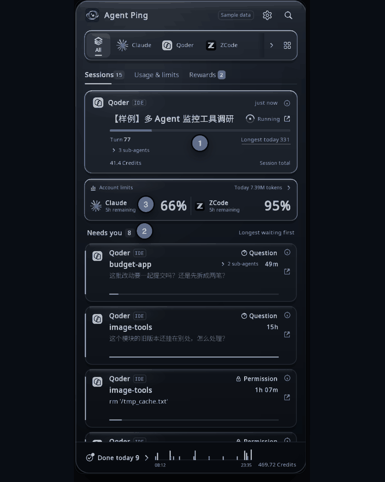
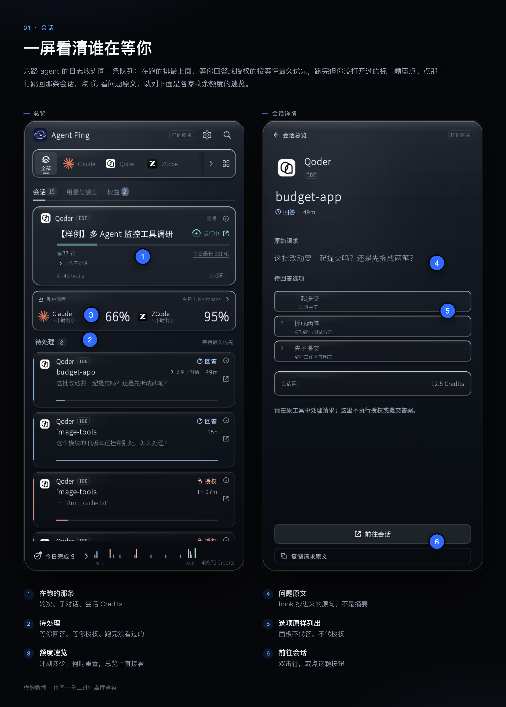
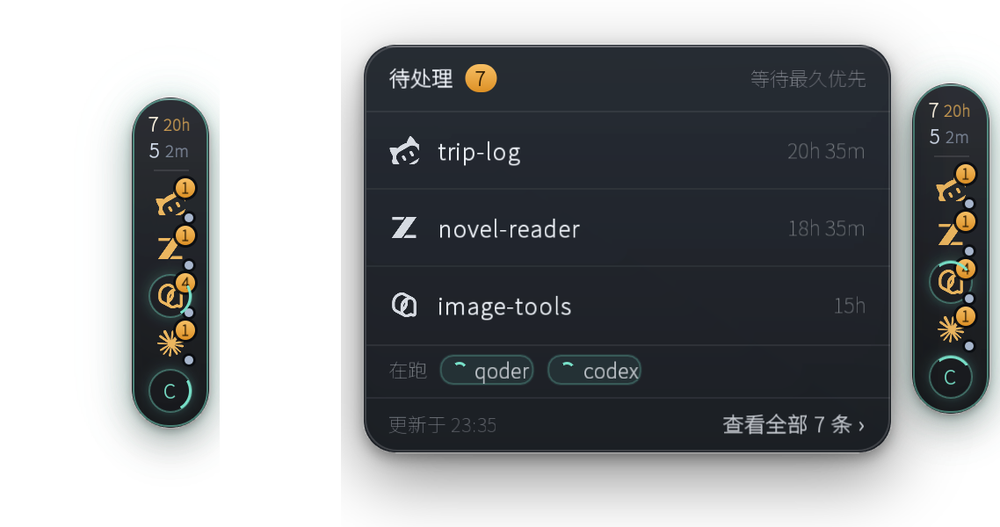
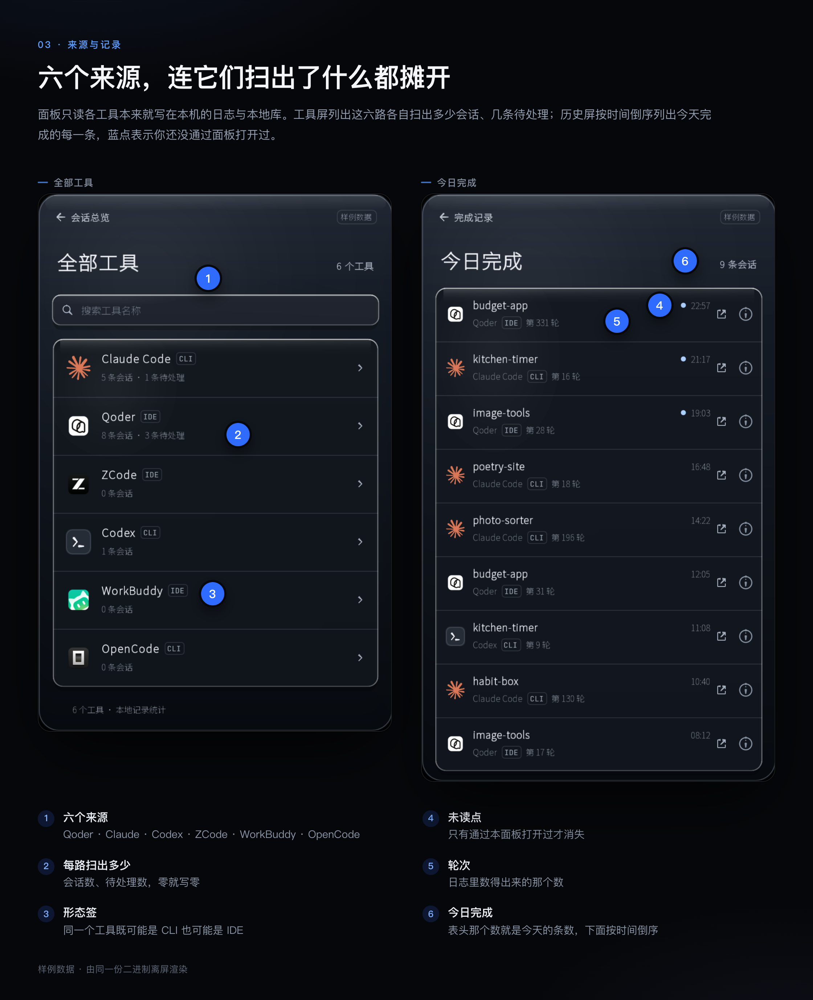

# Agent Ping


[English](README.md) · [产品页](https://dreamofxm.github.io/agent-ping/)

[安装](#安装) · [怎么用](#怎么用) · [隐私](#隐私它到底读什么) · [已知限制](#已知限制)

好几个 agent 工具同时在跑，谁完成了、谁在等你授权，容易漏看。Agent Ping 是一个菜单栏面板，读这些工具写在机器上的本地日志。谁在等，一眼看到；双击，跳回那条会话。

[](docs/agent-ping-teaser.gif)

## 安装

按平台选：**macOS 13+** → 本节两条路；**带 X11 的 Linux** → 只有[构建](#构建)一条路；
**Windows** → 暂不支持。

**推荐：cask（预编译，进「应用程序」文件夹）**

```sh
brew tap DreamOfXM/agent-ping https://github.com/DreamOfXM/agent-ping
brew trust dreamofxm/agent-ping          # 第三方 tap，只需要跑一次
brew install --cask agent-ping
```

装完在 `/Applications/Agent Ping.app`，启动台和访达都看得到。包已含 glfw 和freetype，不用先装依赖。从 v0.1.3 起经过 Apple 公证，正常安装不弹「无法验证开发者」。真弹了，别放行，来 [Issues](https://github.com/DreamOfXM/agent-ping/issues) 说一声。

**备选：formula（源码现编，不进「应用程序」）**

想自己编一份、或者 26 MB 下不动，用这条。需要 Xcode 命令行工具，Apple 芯片上约一分钟。

```sh
brew tap DreamOfXM/agent-ping https://github.com/DreamOfXM/agent-ping
brew trust dreamofxm/agent-ping
brew install agent-ping
agent-ping
```

<details>
<summary>brew 停在 Homebrew 的 Xcode 准入检查</summary>

`Error: Xcode alone is not sufficient…` 是 Homebrew 对源码构建的要求，不是本项目的。Command Line Tools 太旧的话，去系统设置 → 软件更新里更新它。嫌麻烦就直接用上面的 cask，全程不碰编译器。

</details>

**装完找不到它？** 它没有 Dock 图标，聚焦也搜不到——设计使然。跑起来后，菜单栏右端会出现「椭圆里一颗星」的图标。第一次启动会自动打开面板。

升级与卸载按安装时走的那条路：

```sh
brew update                               # 先更新 tap
brew upgrade --cask agent-ping            # cask 装的
brew upgrade agent-ping                   # formula 装的
```

```sh
brew uninstall --cask agent-ping          # cask 装的
brew uninstall agent-ping && brew untap DreamOfXM/agent-ping   # formula 装的
```

两种都装过会出两个菜单栏图标——留一个就好。

## 怎么用

- **总览屏**把等你授权、等你回答、出错结束的会话排成「待处理」队列。双击一行，跳回那条会话。
- **用量与额度屏**看各家的余额和今日用量。**权益屏**看各家自己记的可领状态。
- **面板收起后**，屏幕右缘留一根 44pt 窄柱：谁在等、谁刚完成，不切窗口就知道。
- **提醒**按会话去重，只发一次。横幅发不出去改用声音。「免打扰」只暂停发送。
- **界面**内置中／英／德／意／日／韩六种语言，设置屏直接切换。

[](docs/fig-01-queue-zh.png)

*本文图片由程序自己用演示数据渲染；「样例数据」标签是产品自己的。*

[](docs/fig-04-edge-zh.png)

**数字哪来的？** 全部读自各家工具自己写的本地日志。不走账单接口，不换算成金额。日志里没有的，那一格就不显示。逐屏导览和每个数字的完整定义在[产品页](https://dreamofxm.github.io/agent-ping/)。

**想看到问题的原文和选项？** 光读日志不够，要接 hook。Claude Code 和 Qoder CLI 在面板的**接线**屏点一下按钮就接上了。hook 只把问题抄进本地收件箱，从不替你回答。

## 隐私——它到底读什么

[](docs/fig-03-sources-zh.png)

没有服务端、没有账号、没有埋点。下面每一条都读你自己工具本来就有的文件，不上传任何东西，二进制里没有网络调用。

- **Qoder CLI** — `~/.qoder/projects/**/*.jsonl`：会话、标题、工作目录、时间、token 与 Credits 用量、轮数
- **Claude Code** — `~/.claude/projects/**/*.jsonl`：同上，不记 Credits
- **Codex** — `~/.codex/sessions/**`：会话、工作目录、token 用量、结果、额度读数
- **ZCode** — `~/.zcode/cli/db/db.sqlite`：会话、每条的最后一句、token 用量、子代理记录，还有没回完的那条「等你回答」（只读）
- **WorkBuddy** — `~/.workbuddy/workbuddy.db`、`~/.workbuddy/projects`：会话、token 用量
- **OpenCode** — `~/.local/share/opencode/opencode.db`（认 `$XDG_DATA_HOME`）：标题、工作目录、更新时间、token 用量、工具状态（只读）
- **权益领取** — `~/.workbuddy/logs/main.log`、`~/Library/Application Support/com.qoder.app.stable/logs/*/main.log`、`~/.zcode/v2/logs/<日期>.log`：各家自己记的签到结果、可领状态、面值与作废时间
- **账户余额** — `~/.codex/sessions/**`、`~/Library/Application Support/com.qoder.app.stable/logs/*/main.log`、`~/.zcode/v2/logs/<日期>.log`：各家记的「还剩多少／一共多少」，和写下时间
- **Hook 收件箱** — `~/Library/Application Support/AgentPing/hooks/*.json`：等你回答的问题原文与选项。只有装过 hook 才有内容

Linux 上 Agent Ping 自己的路径在 `$XDG_CONFIG_HOME` 和 `$XDG_DATA_HOME` 下，没设就用 `~/.config` 和 `~/.local/share`。

它**不读** Keychain、环境变量里的密钥、auth token、shell 历史，也不读上面没列的内容。

它会写的只有：状态目录里的两个记录文件；装 hook 时的 `hook.sh` 和两份 CLI 配置（改前先备份）；开着「登录时启动」时的登录项；Linux 通知失败时的一个临时日志。

会话标题会显示在屏幕上，提醒里也有原文——截图分享时注意这一点。

## 已知限制

提 issue 之前先读这段，每条都写了原因：

- **macOS 横幅可能被系统拒发。** 去系统设置 → 通知里放行。之前面板改用声音。
- **跳进 ZCode 会话是绕路。** 靠敲它自己的 ⌘K 检索，需要辅助功能授权。没授权只能唤起 App。
- **未读点不与工具联动。** 它的含义是「没通过本面板打开过」。
- **权益卡只能事后确认。** 没领的那一期不在本机日志里。读数只在各家写盘时才变。
- **Linux 的状态项和出声还年轻。** 只在容器里验过，没上过真桌面和真硬件。
- **Linux 点横幅不跳会话。** 只能唤起 App，或打开会话的工作目录。
- **只支持六个来源。** Qoder CLI、Claude Code、Codex、ZCode、WorkBuddy、OpenCode。后三个要带 SQLite3 的构建。
- **没有真背景模糊；深底托盘图标不太显眼。** 修后者要重画已定稿的标识。
- **搜索框键盘焦点未实测。** 打字没有过滤效果的话，请报 issue。
- **设置、接线、授权三屏还是旧版面。** 其余屏已重做，这三屏会跟上。
- **资源重置卡不实现。** 本地日志没有这项，就不显示。

## 构建

要 C++17、CMake ≥ 3.20、Ninja、GLFW3、FreeType 2、OpenGL 3.3 core，macOS 13+ 或带 X11 的 Linux。可选依赖缺了会怎样，CMake 都会明说：SQLite3 缺了，跳过 ZCode、WorkBuddy、OpenCode 三路；Linux 上 libdbus-1 缺了没有托盘图标，libx11 + libxext缺了窄柱关着。命令都在仓库根目录跑。

macOS（产出 `build/AgentPing-cpp.app`）：

```sh
brew install cmake ninja glfw freetype
cmake -S . -B build -G Ninja && cmake --build build
sh Tools/make_bundle.sh
```

Linux（Debian 12 包名）：

```sh
sudo apt-get install -y cmake ninja-build libglfw3-dev libfreetype6-dev \
    libsqlite3-dev libgl1-mesa-dev libdbus-1-dev libx11-dev libxext-dev
cmake -S . -B build-linux -G Ninja && cmake --build build-linux
# 提醒层要真行为还需两个包：libnotify-bin（横幅）、sound-theme-freedesktop（出声）
```

每次推 main，CI 都在 Debian 12 容器里把上面那条 apt 命令原样跑一遍，再构建、量窄柱的点击穿透。包列表就是从这份 README 里读的，失效会报错，不会悄悄过期。

装进应用菜单：

```sh
sudo cmake --install build-linux            # 前缀默认 /usr/local
```

菜单里找不到，就加 `--prefix /usr` 重装。

## 文档与反馈

- [产品页](https://dreamofxm.github.io/agent-ping/) —— 功能导览、同类对比、常见疑问在那边。它的「隐私」链接回到的是这一节。
- [Issues](https://github.com/DreamOfXM/agent-ping/issues) —— 报 bug、许愿新工具，中英文都行。先读[已知限制](#已知限制)。

## 许可

Apache License 2.0 — 见 [LICENSE](LICENSE)。

第三方材料保留各自条款：Dear ImGui 是 MIT（`vendor/imgui/LICENSE.txt`），界面字体是SIL OFL 1.1（`fonts/LICENSE-*.txt`）。Noto CJK 带保留字体名 `Source`：可以改，但改完不得沿用那个名字。
