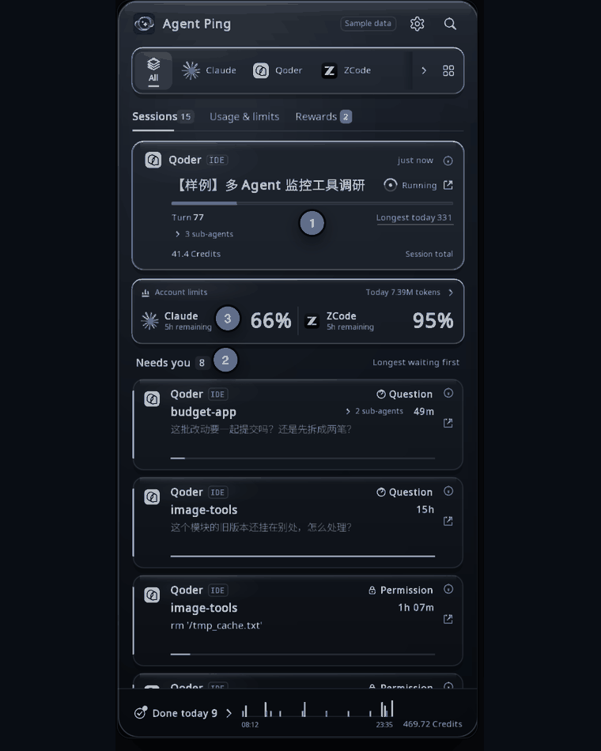
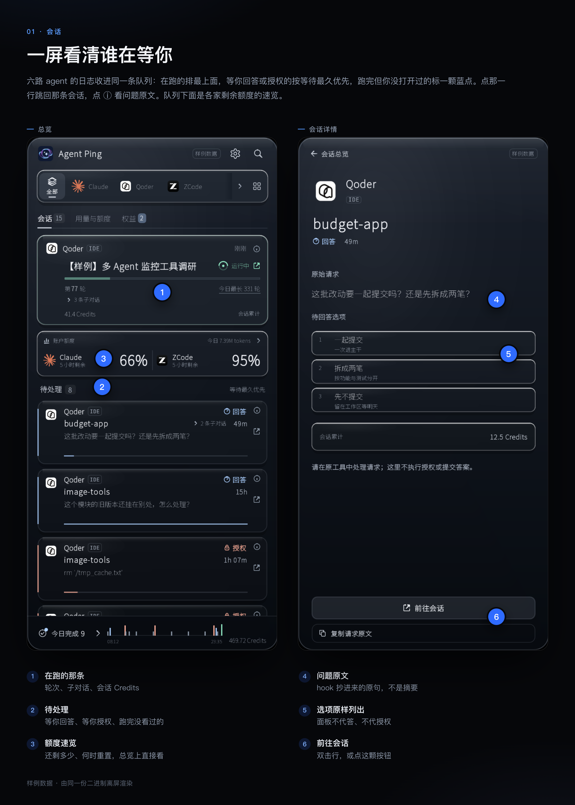
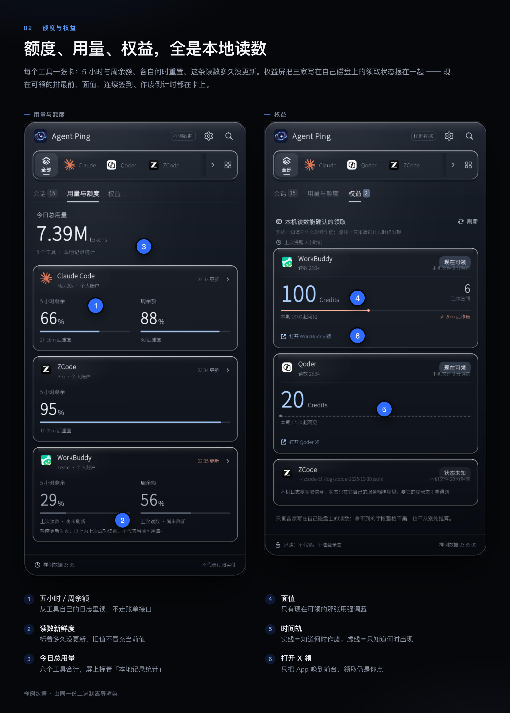
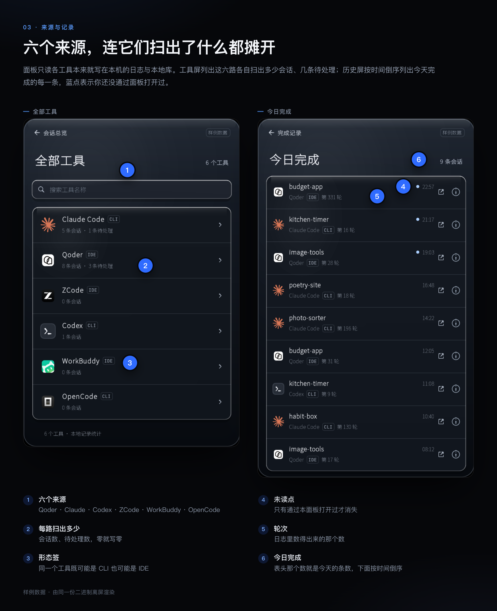

# Agent Ping


[English](README.md) · [产品页](https://dreamofxm.github.io/agent-ping/)

同时开着 Qoder、Claude Code、Codex、ZCode、WorkBuddy、OpenCode 的时候，你缺的不是又一块
看板，而是「现在轮到哪一条」。Agent Ping 是一个菜单栏面板：它读这些工具已经写在你机器上
的日志与本地库，算出谁在跑、谁在排队、谁报错停了、谁正等着你回答、谁家又出了一张可领的券；
然后在你没看屏幕的时候提醒你，并把对应的会话或权益屏递到你面前。没有服务端、没有账号、
没有埋点：二进制里没有任何网络调用（用 `nm -u` 核过，见[隐私](#隐私它到底读什么)）。





*本文三张组图都由本仓库编译出的二进制离屏渲出来（`AGENTPING_FIXTURE=1`），不是摆拍。
表头那颗「样例数据」是产品自己挂的标签：图里的数字不来自任何一台真机。*

## 它是什么，以及它故意不做什么

**是**：一个实时状态监视器 + 一层提醒 + 一条回到那条会话的路。价值的单位是「一行」——
一个会话、一个状态、一个跳转目标。从 v0.1 起它也显示账户额度与 token 用量，因为
「我这 5 小时的窗口还剩多少」是一个*此刻*的问题，不是一个记账问题。十月起它还把三家写在自己
磁盘上的权益领取状态摆上屏——只读、不代领，点了只会把那家 App 带到前台。

**不是**：成本看板，也不是自动领取器。它从不把任何东西换算成金额、从不调账单接口、从不显示
一个没从本地日志里读到的额度、从不替你点「领取」。某个来源没有那个字段，界面就不画那一格，
而不是填个 `0`。时间窗只有一个：今天。

## 界面

一个窗口十屏。顶上那条导轨按工具筛选，下面所有屏读的都是同一轮扫描——表里把设置、接线、
授权并成一行。

| 屏 | 回答什么 |
|---|---|
| **总览** | 一处在跑的卡（轮次、子对话、会话 Credits）、账户额度速览、「待处理」队列按等待最久优先，页脚是今日完成的时间轴 |
| **用量与额度** | 今日 token 总量，外加每个工具一张卡：5 小时／周余额、各自何时重置、这条读数多久没更新了 |
| **权益** | 三家的权益卡：现在可领的排最前，面值、连续签到、作废倒计时都在卡上；拿不到的字段整格不画 |
| **账户** | 单个工具：总用量、按小时分布、输入／输出／缓存读取／缓存写入、按模型拆分 |
| **详情** | 待回答的原文与选项，或者失败的那条命令——点任意一行的 `ⓘ` 进来 |
| **历史** | 完成记录，新的在前，一页 12 条，滚到底自动续页 |
| **工具** | 这台机器上有哪些采集器在，各自扫出了什么 |
| 设置 / 接线 / 授权 | 开关、hook 接线状态、辅助功能授权提示 |



*一张权益卡上有三层不同的时刻：读数时刻、源文件最后写入的时刻、页脚这次扫描的时刻。它们
对不上时，「我们没刷」和「那家没写」是可以分开看的两个答案。*

## 跨平台

两个平台每次发版都真编真跑。平台差异全在 `src/platform/` 里，藏在 C 头文件后面，
所以面板、采集层和提醒判据只有一条代码路径。

| | macOS | Linux |
|---|---|---|
| 窗口 | 无边框、透明、跟着菜单栏项落位 | 同，走 GLFW/X11 |
| 状态项 | `NSStatusItem`，标签是三个数 | D-Bus 上的 StatusNotifierItem（要 `libdbus-1-dev`，没有就退成无托盘的占位实现） |
| 横幅 | `UNUserNotificationCenter` | 起子进程跑 `notify-send`（来自 `libnotify-bin`） |
| 提示音 | `afplay` 播系统音 | 按安装情况依次试 `paplay` → `pw-play` → `ffplay` → `canberra-gtk-play` → `aplay` → `cxplay`，并匹配文件格式（`aplay` 只吃 `.wav`，`paplay` 就不试 wav） |
| 登录时启动 | `~/Library/LaunchAgents` 下的 plist | `$XDG_CONFIG_HOME/autostart` 下的条目 |
| 跳进会话 | URL scheme、AppleScript，或驱动该工具自己的 ⌘K 面板 | 唤起 App 或打开记录里的工作目录，没有面板驱动 |
| 界面语言 | 跟随系统，可覆盖 | 跟随 `$LC_*` / `$LANG`，可覆盖 |

界面文案内置六语（中／英／德／意／日／韩），设置屏是真下拉；字号在启动时逐档烘焙，
CJK 不是后贴的补丁。

## 它的行为约定

下面每一条都是踩出来的，不是设计时想到的：

- **跳会话要双击。** 一次误触的代价是面板收起 + 跳走，所以整行只在 0.5 秒内对同一行
  第二次点击才发火。小件（`ⓘ`、详情页的「前往会话」、芯片）仍是单击。
- **卡片不漂移。** 每 3 秒重扫一次，而各条会话拿到输出的时间不同；按「最后动静」排序
  会让行从光标底下跑掉。每条会话在面板第一次看见它时领一个递增序号，老卡之间因此永不
  换位。
- **完成的会话带未读点**，直到你*通过这个面板*打开它。水位线落盘持久化；首次启动时
  初始化为「此刻」，所以存量不会一进来就变成 40 条未读。
- **面板多高由内容定**（400–850 pt），滚轮是朝目标缓动，不是一格瞬移 40 pt。
- **开关会回话。** 把「提示音」翻到开，当场播一声测试音并弹文字回执，不用等下一次提醒
  才知道它到底生效没有。
- **陈旧读数会退场。** 总览只预览 ≤10 分钟的额度读数，更旧的退到用量屏、带上
  「上次读数」的时间戳，而不是在首页常驻一颗红色「待更新」。
- **权益只读，不代领。** 卡上只画各家写在自己库里的字段。点卡只会把那家 App 带到前台，
  回执直说「领取仍要你自己在那家 App 里点 — 这一层不代领」；整张卡都是落点，但落点只到 App。

## 隐私——它到底读什么



下面每一条都是读一个你自己的工具本来就拥有的文件。不上传任何东西。Agent Ping 只写
表后列出的那几个文件，而两份配置文件只在**你**主动装 hook 时才碰（接线屏那个按钮，
或 `Tools/install_hook.sh`）。

| 来源 | 路径（macOS） | 从里面取什么 |
|---|---|---|
| Qoder CLI | `~/.qoder/projects/**/*.jsonl` | 会话 id、标题、cwd、时间戳、`message.usage` 的 token/credits 字段、user 记录条数 |
| Claude Code | `~/.claude/projects/**/*.jsonl` | 同上，减去 credits（那边没有这个字段） |
| Codex | `~/.codex/sessions/**` | `session_meta`（cwd、会话 id）、`token_count` 记录、结果、`rate_limits` 事件 |
| ZCode | `~/.zcode/cli/db/db.sqlite` | `chat_sessions` + 每条会话最后一句、`tokens.input` 之和、子代理记录（只读） |
| WorkBuddy | `~/.workbuddy/workbuddy.db`、`~/.workbuddy/projects` | 会话行、`providerData.usage.inputTokens` |
| OpenCode | `~/.local/share/opencode/opencode.db`（认 `$XDG_DATA_HOME`） | `session` 的标题/cwd/`time_updated`、`part` 的 `step-finish` token 之和与 `tool.state.status`（只读） |
| 权益领取 | `~/.workbuddy/logs/main.log`、`~/Library/Application Support/com.qoder.app.stable/logs/*/main.log`、`~/.zcode/v2/logs/<日期>.log` | WorkBuddy 的 `[Checkin]` 签到结果；Qoder 的 `[Campaign]` 可领状态与服务端清单；ZCode 的 `billing/balance` 响应——本期计划、`grant_units` 面值与作废时刻，由 ZCode 自己的 App 落盘，CLI 侧没有 |
| Hook 收件箱 | `~/Library/Application Support/AgentPing/hooks/*.json` | 待回答原文与选项——由 Agent Ping 应你要求装进去的那个 `hook.sh` 写；面板自身从不往这个目录写 |

Linux 上 Agent Ping 自己的两条路径改到 `$XDG_CONFIG_HOME/AgentPing/…`（收件箱，取不到
就退回 `~/.config`）与 `$XDG_DATA_HOME/agentping/hook.sh`（退回 `~/.local/share`）。
设 `AGENTPING_HOOK_DIR` 可以让写方和读方一起换到别的收件箱。

它**不读** Keychain、环境变量里的密钥、auth token、shell 历史，也不读转录里除上表字段
之外的内容。它不开任何 socket：编译出的二进制里没有一条未解析的 `connect`、`sendto`、
`getaddrinfo`、`socket` 或任何 HTTP 客户端符号——Linux 构建里唯一带 connect 字样的是
`dbus_connection_*`，那是本机 IPC。

它会写的文件：

| 文件 | 什么时候写 |
|---|---|
| 状态目录里的 `alerted.txt`、`settings.txt` | 总是（去重账本、设置、未读水位线） |
| `<hook.sh 路径>` | 只在你装 hook 时；`0755`，原子写 |
| `~/.claude/settings.json` / `~/.qoder/settings.json` | 只在你装 hook 时：按 matcher 各并一条 `Notification` 进现有 JSON |
| `<那个配置>.bak-agentping-<YYYYmmdd-HHMMSS>` | 合并之前，存原始字节 |
| macOS `~/Library/LaunchAgents/io.github.dreamofxm.agentping.plist`、Linux `~/.config/autostart/agentping.desktop` | 只在「登录时启动」开着的时候 |
| `/tmp/agentping-err-<pid>.log` | 仅 Linux，`0600`，仅当通知失败 |

会话标题会显示在屏幕上，也是提醒里被引用的内容——请把它当成你自己的终端回滚缓冲来看待。

## 屏幕上每个数字的口径

| 屏幕上 | 定义 | 说实话的部分 |
|---|---|---|
| 托盘 `2 · 5` | 三档计数按固定顺序排：需要你介入、运行中、失败中断；为 0 的那档不占字位 | 「运行中」并进了排队；哪格是哪档由悬停说明给出，标签本身说不出 |
| `待处理 N` | 今天窗口内等你动手的（授权、回答、以错误结束）**加上** 今天已结束但你还没打开看过的会话 | 第二段行上写「待查看」、标蓝；它不进托盘那三个数——没人需要动手 |
| `运行中 N` | 在跑的 **加上** 排队的 | |
| `41.4 Credits` | 时间戳落在本地零点之后的 assistant 记录里 `message.usage.credits` 之和 | 只有 Qoder CLI 有 `credits` 字段。那是那家自己记的计数，不是我们估的，也不是钱。没有该字段的来源贡献 0 |
| `第 77 轮` | 不带 `toolUseResult` 键的 `type:"user"` 记录条数 | 任何本地日志都没有「总轮数」，所以进度画成流动条，绝不画成百分比 |
| `今日最长 331 轮` | 同一个轮次计数，取今天所有会话的最大值 | |
| `⌄ 3 条子对话` | ZCode 里 `task_type='subagent_child'` 且按 `parent_id` 挂回这条会话的记录 | ZCode 不给子对话起名；标签是从派单原文推出来的，而 ⌘K 检索用的仍是原文 |
| `今日总用量` | 今天每条会话的 `输入 + 输出 + 缓存读取 + 缓存写入` 求和（各工具自报的四项） | 这四项在不同工具之间**不是同一个意思**，见下面那段 |
| `66%` / `2h 16m 后重置` | 从那个工具自己的日志里读出来的一档额度窗口（比如 Codex 运行时会写 `rate_limits` 事件） | 本地读取，绝不走账单接口；工具闲置时这条读数就是旧的，界面会说是旧的 |
| 权益卡 `100 Credits`／`6 连续签到`／`5h 20m 后作废` | 各家自己写盘的面值、连续天数与本期失效时刻 | 哪家不写就整格不画；`现在可领`／`本期已领` 是它自己的状态位，不是我们推算的；只报「何时出现」的那家，时间轨画虚线 |
| `按小时` 柱 | 该工具的 token 累加进本地 0–23 点共 24 格 | 没有 token 的那一格留空，不画成 0 |

token 之所以相加，是因为用量屏就是要一个总量；但这个和混着口径：转录层加的是
`input + cache_read + cache_creation`，Codex 报的是累计总量，ZCode 存 `tokens.input`，
WorkBuddy 的 `inputTokens` 本身已含缓存读，OpenCode 每轮写一条 `step-finish`。所以
面板把那个数标成「本地记录统计」，每张工具卡自带「updated HH:MM」，账户屏把公式写在
屏幕上。要拿数做决定，请用单工具那一格；顶上那个总数是个形状，不是测量。

## 提醒

每条会话按 `(agent, session)` 这个键只提醒一次。账本在磁盘上，重启不会把整版重吵一遍。
每轮最多发 4 条，其余压到后面某轮再发，而不是丢掉。「免打扰」只压新提醒，不清账本。

`ap_notify_post` 返回四个码之一，区别很重要：

| 码 | 含义 | 账本 |
|---|---|---|
| 0 | 横幅已投递 | 记账 |
| 1 | 横幅通道不可用，退到出声 | 记账 |
| 2 | 两条通道都不通 | 记账，并在设置屏显示出来 |
| 3 | 平台在时限内没回执 | **键被擦掉**——本轮不算发出，下轮可重试 |

**权益到账**走同一套账本、另一个键（`claim:<vendor>:<期次>`）：某家从「没有」翻成
「现在可领」时弹一张横幅，不点不收、点了才消失，点横幅落到权益屏。设置屏的「权益到账提醒」
可以关掉这一路（默认开），免打扰也会压住它——两者都只压投递、不清账本，所以重新打开时
不会把关闭期间攒下的期次一次涌出来。

## 接线（可选）

只读日志就能判出会话状态，但看不到问题的*原文*和权限提示的选项，那需要 hook。两个
CLI 的 hook 可以替你写进去：

```sh
./Tools/install_hook.sh status            # 哪些已接、哪些过期
./Tools/install_hook.sh install claude    # 或 install qoder
./Tools/install_hook.sh uninstall claude
```

同样三个动作也在面板的**接线**屏里；那里的按钮走的就是这条安装路径，两个入口不可能
各说各话。

`install` 按顺序做三件事：

1. 在自己的数据目录里写 `hook.sh`（原子，`0755`）；
2. 把目标配置备份成 `<config>.bak-agentping-<YYYYmmdd-HHMMSS>`；
3. 给 `permission_prompt` 与 `idle_prompt` 两个 matcher 各并一条 `hooks.Notification`，
   command 是 `'<hook.sh>' <agent>`，然后原子写回配置。

hook 只做一件事：把 CLI 给的 JSON 抄进收件箱。它从不替你回答提示，而且即使收件箱写
不进去也退 0——CLI 会把 hook 的退出码读成一个决定。

Codex 是只读检测：如果 `~/.codex/config.toml` 里的 `notify` 属于别的工具，面板会说出
来并且不动那个文件。ZCode、WorkBuddy、OpenCode 没有 hook 通道，状态只从它们自己的
本地库来，所以详情屏里问题原文与选项对它们为空。

## 依赖

- C++17、CMake ≥ 3.20、Ninja
- GLFW3、FreeType 2、OpenGL 3.3 core
- 可选 SQLite3（没有它，ZCode、WorkBuddy、OpenCode 三路被跳过，构建会警告）
- 可选 libdbus-1（Linux 状态项；没有它构建退成无托盘图标的占位实现）
- macOS 13+ **或** 带 X11 的 Linux；横幅要 `notify-send`，出声要
  `paplay`/`pw-play`/`ffplay`/`canberra-gtk-play`/`aplay`/`cxplay` 里任意一个

该走哪扇门，一行说完：**macOS 13+** → 下面的 Homebrew，或者「构建」一节；
**带 X11 的 Linux** → 只有「构建」一条路，没有对应的 formula；
**Windows** → 暂不支持，`src/platform/` 只带了 macOS 与 POSIX 两套垫片。

## 用 Homebrew 安装（macOS 13+）

装的是同一个 App，两条路只差一件事：**它落不落在「应用程序」文件夹里**。想要双击就能打开
的那种，走第一条。

**推荐：cask（预编译，进 `/Applications`）**

```sh
brew tap DreamOfXM/agent-ping https://github.com/DreamOfXM/agent-ping
brew trust dreamofxm/agent-ping          # 第三方 tap，只需要跑一次
brew install --cask agent-ping
```

Apple 芯片和 Intel 各有预编译包（各约 26 MB），cask 按机型自己挑，不会把 Apple 芯片的包
装到 Intel 机器上。装完 `/Applications/Agent Ping.app` 里就有它，启动台和访达都看得到。

包是自包含的：glfw 与 freetype 静态链在可执行文件里，**不需要**你先装这两个依赖 ——
那两个是编译版（formula）才需要的。

> 它用的是 `version :latest`，所以升级必须带 `--greedy`：
> `brew upgrade --cask --greedy agent-ping`。不带的话普通 `brew upgrade` 会跳过它。

> **关于「无法验证开发者」这个弹窗**：从 v0.1.3 起，两份预编译包都用 Developer ID
> 证书签名、送 Apple 公证并已完成 staple。`spctl -a` 判 `accepted`，来源是
> `Notarized Developer ID`；浏览器下载和 cask 安装都会打隔离标记，但带隔离标记照样能过。
>
> 所以正常安装不该弹这个窗。真弹了，先怀疑拿到的是旧包（`version :latest` 升级时没带
> `--greedy`），跑一次 `brew upgrade --cask --greedy agent-ping`。上游二进制被中间层换过
> 也会这样，此时**先核对签名再放行**：
>
> ```sh
> codesign -dv --verbose=4 "/Applications/Agent Ping.app" | grep -E 'Authority|TeamIdentifier'
> # 应当看到 Developer ID Application: Xiaoming Guo (448JJF25MY)
> ```
>
> Team ID 对得上、又确实要放行一次，走这两条之一：
>
> - 系统设置 → 隐私与安全性，滚到下面写着「Agent Ping 已被阻止」的那一行，按**仍要打开**。
> - 或者在终端里：`xattr -dr com.apple.quarantine "/Applications/Agent Ping.app"`

**备选：formula（从源码编译，不进 `/Applications`）**

不想用预编译二进制、想自己编一份，或者 26 MB 实在下不动的时候用这条。它从本仓库
[v0.1.4](https://github.com/DreamOfXM/agent-ping/tree/v0.1.4) 标签的源码现场编译，
第一次装需要 Xcode 命令行工具，Apple 芯片上大约一分钟。

```sh
brew tap DreamOfXM/agent-ping https://github.com/DreamOfXM/agent-ping
brew trust dreamofxm/agent-ping
brew install agent-ping
agent-ping
```

> 如果 `brew install` 停在 `Error: Xcode alone is not sufficient on …` 或
> `Your Command Line Tools are too outdated`：那是 Homebrew 对**源码构建**的准入检查，
> 不是本项目的要求 —— 它要先确认系统里有一份够新的工具链，才肯编译任何 tap 里的 formula。
> `xcode-select --install` 只在工具完全没装时管用；装了但太旧的时候，去更新它：系统设置 →
> 通用 → 软件更新，或者先 `softwareupdate --list`，再
> `sudo softwareupdate -i "Command Line Tools for Xcode <版本>"`。再不然直接用上面的
> cask，全程不碰编译器。这些都不想看，下面「构建」一节用 Xcode 自带的 clang 也能编出同样的
> 东西 —— app 本身不挑编译器年龄：macOS 27 配一份 2025 年的命令行工具，一次就编过了。

`agent-ping` 是一行启动器，打开的是 Homebrew `opt` 目录里的 App
（`$(brew --prefix)/opt/agent-ping/Agent Ping.app`）。它**不会**进 `/Applications`：
Homebrew 的构建跑在沙箱里，写不了那里 —— 想要应用程序文件夹里那一份，用 cask。要开机自启，
在面板里打开**登录时启动**；它写的 LaunchAgent 指向 `opt` 这条路径，所以 `brew upgrade`
之后登录项仍然有效。

**装完之后找不到它？** 它没有 Dock 图标，聚焦也搜不到——这是设计使然（`LSUIElement`）。
全部 UI 就是菜单栏：跑起来之后，菜单栏右端、时钟左边会出现那个「椭圆里一颗星」的图标；
第一次启动它会把面板自己弹出来，所以你能看到东西，关掉之后图标留在那儿。

**升级与卸载**

```sh
brew upgrade --cask --greedy agent-ping   # cask，--greedy 必须带
brew upgrade agent-ping                   # formula

brew uninstall --cask agent-ping
brew uninstall agent-ping && brew untap DreamOfXM/agent-ping
```

两种都装过的话，菜单栏会同时出现两个图标——留一个就好。

## 构建

macOS（最近一次实跑 2026-10-28，产出 `build/AgentPing-cpp.app`；其中约 40 MB 是随包
的 `fonts/`，所以体积随字体变，不随代码变）：

```sh
brew install cmake ninja glfw freetype
cmake -S . -B build -G Ninja && cmake --build build
sh Tools/make_bundle.sh
```

Linux（Debian 12 包名；2026-10-30 在全新 Debian 12 容器里照下面三行装成、构建、跑起来并截到界面）：

```sh
sudo apt-get install -y cmake ninja-build libglfw3-dev libfreetype6-dev \
    libsqlite3-dev libgl1-mesa-dev libdbus-1-dev
cmake -S . -B build-linux -G Ninja && cmake --build build-linux
# 提醒层要真行为还需两个包：libnotify-bin（横幅）、sound-theme-freedesktop（出声）
```

精简容器镜像还得补 `build-essential`（或别的编译器）；`libdbus-1-dev` 决定的是走真
状态项还是占位实现。

装到桌面找得到的地方——应用菜单里一个有名有图标的条目，而不是一个得记住路径的裸二进制：

```sh
sudo cmake --install build-linux            # 前缀默认 /usr/local
agent-ping                                  # 或者在应用菜单里点「Agent Ping」
```

它会把 `agent-ping` 放进 `<prefix>/bin`，随包的字体与托盘图标主题放进
`<prefix>/share/agent-ping`，`agent-ping.desktop` 与 hicolor 图标放进 `<prefix>/share`。
若你的发行版没把 `/usr/local` 列进 `XDG_DATA_DIRS`（主流发行版都列了），加 `--prefix /usr`。

## 不开显示器也能试

```sh
./build/pin_imgui_shell --dump            # 一轮扫描按文本输出，不开窗口
D=$(mktemp -d); AGENTPING_STATE_DIR=$D ./build/alert_probe --selftest   # 56 条断言，离线
./build/alert_probe --channel             # 横幅通道活着吗？0/1/2
./build/alert_probe --post                # 一条合成提醒，端到端
./build/pin_imgui_shell --hook-status     # 每个 CLI 的接线状态，按文本
xvfb-run -a -s "-screen 0 1400x1100x24" ./build/pin_imgui_shell --dump
```

上面这些路径是 macOS 的构建目录 —— Linux 上这两个二进制在 `build-linux/` 里，这些命令
每一条都在 Debian 12 容器中实跑过。

`--dump` 就是对账工具：屏幕上每个数在它里面都有一行，所以面板和现实不一致时，你在
终端就能判是谁错了。

本文的组图来自同一个二进制的离屏探针——它把六语并排渲成一张 PPM：

```sh
AGENTPING_FIXTURE=1 AGENTPING_VIEW=0 ./build/pin_imgui_shell fonts /tmp/panel.ppm
# 屏号：0 总览 · 3 详情 · 4 授权 · 5 历史 · 6 用量 · 7 账户 · 8 工具 · 9 权益
```

## 已知限制

提 issue 之前先读这段——每条都是写明成因的已知缺口，不是谜。

- **macOS 横幅可能被拒。** v0.1.3 起包已用 Developer ID 签名并公证，通知系统不会
  再因为「构建没有正确签名并注册」而静默拒收；剩下的成因是系统通知权限没打开，面板于是退到
  出声（码 1）。到系统设置 → 通知里放行。
- **跳进 ZCode 的某条会话是绕路，不是接口。** ZCode 不暴露会话级 URL，也没有 CLI；面板
  是把这条会话的检索词元敲进它自己的 ⌘K 面板，这一步需要 macOS 辅助功能授权。没授权时
  落点降级成「唤起 App」。另外，任务所在工作区如果从没在 ZCode 界面里打开过，它的搜索
  池里就没有这条——那是 ZCode 侧的边界。
- **未读点不与工具联动。** ZCode 的已读状态存在它 renderer 的内存里，不落盘，所以在
  ZCode 里读完不会让这里的点消失。这个点的含义是「没通过本面板打开过」。
- **ZCode 的权益卡只能在领完之后确认这一期。** 状态来自它 App 写进 `~/.zcode/v2/logs/<日期>.log`
  的 `billing/balance` 响应；还没领的那一期不会出现在这份日志里，所以面板不可能提前预告——
  那时卡上写的是「本机没有活期」，这句只关于本机，不等于「那家没有券」。面值取该响应的
  `grant_units`（本期发的总额，不是剩余额度），作废时刻取同一条 `ends_at`，本机没有日志记录「领取」这个动作。
- **权益读数只在各家自己刷新时才变。** WorkBuddy 的 `[Checkin]` 只在它窗口聚焦时刷新；
  面板不催它，只在卡上如实写「本机文件 X 前」，让你分得清「我们没刷」和「那家没写」。
- **Linux 状态项很年轻。** 带 `libdbus-1` 时构建出的是真 StatusNotifierItem（三数标签、
  悬停说明、左键显隐、右键菜单）。它在容器里对着一个第三方 SNI 宿主验过，**没有**在真的
  KDE/GNOME 桌面上跑过。没有 `libdbus-1-dev` 就退成一个无托盘图标的普通窗口。
- **Linux 出声没在真硬件上验过。** 验证环境没有声卡，所以「它确实响了」这件事没被观察到，
  观察到的是选择器能解析出「播放器 + 文件」这一对、且代码路径正常返回。
- **Linux 上点横幅不跳，** 也没有面板驱动：Linux 的一行退到唤起 App 或打开会话的工作目录。
  投递本身是观察到的——`alert_probe --post` 报出横幅交给了 Xvfb 会话里在跑的 `dunst`——
  但也仅此而已，不是真桌面。
- **没有真背景模糊。** 面板是手画的玻璃表面，不是合成器的模糊——macOS 不给 accessory
  进程一条便宜的取背后像素的路。
- **搜索框能否真拿到键盘焦点，未实测。** 两个搜索框是从 GLFW 的输入队列里取字，而不是
  拥有原生文本框，且面板是 accessory 窗口。⌘/Ctrl+F 与 Esc 已接线、入队那段代码看得见，
  但没有人对着真窗口敲过一次查询并看着它过滤。请把搜索当作未验证；如果它不吃键，那就是
  要报的缺口。
- **设置、接线、授权三屏还是上一版版面。** 其余屏已按新稿重做，这三屏会跟上。
- **资源重置卡不实现。** 没有任何本地日志带它，所以这个字段不建、那一块也不画。
- **hook 安装覆盖两个 CLI。** Claude Code 与 Qoder CLI 能从面板或 `Tools/install_hook.sh`
  接上；Codex 的 `notify` 槽只检测不写；ZCode、WorkBuddy、OpenCode 没有 hook 通道，
  它们的详情屏没有问题原文与选项。
- **六个来源，不是「所有 agent」。** Qoder CLI、Claude Code、Codex、ZCode、WorkBuddy、
  OpenCode。后三个要带 SQLite3 的构建。别的一律不在面板里。
- **深底托盘图标对比度弱。** 深色托盘上只有 19–24% 的亮像素过 WCAG 3:1；浅色托盘 39%。
  要修得出一个单色 symbolic 变体，而那意味着重画已定稿的标识。

## 目录结构

```
src/                面板、采集层、提醒层、平台垫片
src/platform/       notify / open / statusbar / autostart / lang，按 OS 拆开
vendor/imgui/       Dear ImGui 1.93.0 WIP，随仓库带一份，构建不需要网络
fonts/              OFL 许可的界面字体，连同各自许可正文
assets/             Info.plist、App 图标、菜单栏图标、SNI 主题
docs/               本文那些组图，由离屏探针渲出
Tools/              install_hook.sh、make_bundle.sh、各探针
Formula/            Homebrew formula，安装时从这份源码现场编译
CMakeLists.txt      两个平台，含上面那份依赖清单
```

字体是随仓库提交而不是下载，为的是 clone 下来能离线构建；这就是仓库里有约 40 MB 字体
二进制的原因。

## 许可

Apache License 2.0 — 见 [LICENSE](LICENSE)。

第三方材料保留各自条款：Dear ImGui 是 MIT（`vendor/imgui/LICENSE.txt`），界面字体是
SIL OFL 1.1（`fonts/LICENSE-*.txt`）。Noto CJK 带保留字体名 `Source`：可以随意改，但
改出来的版本不得沿用那个名字。
